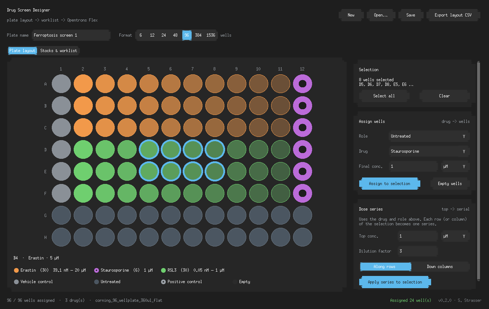
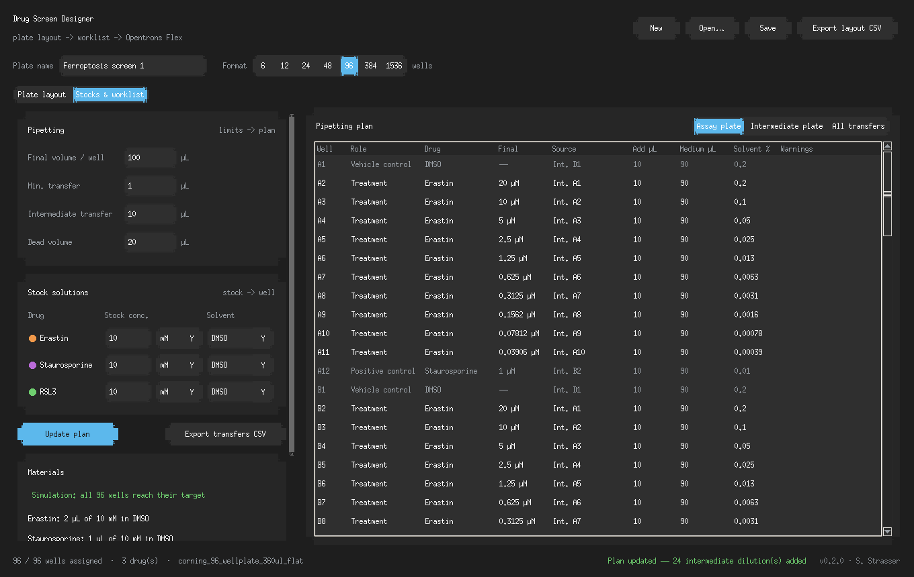

# Drug Screen Designer

Design drug screening plates and generate the pipetting worklist for an
end-to-end screen on the Opentrons Flex. Built for the Physical AI for
Science Hack (San Francisco, Oct 2026), open track.

Shares its core calculation code with the
[Drug Concentration Calculator](https://github.com/steffiAI/drug-dosage-calculator).
The user interface is the Next.js app in [`../web`](../web); this package is the
logic, the web API and the command-line tools. The screenshots show the earlier
desktop version, which the web UI replaces feature for feature.



## Features (v0.3.0)

- **Plate formats**: 6, 12, 24, 48, 96, 384 and 1536 wells
- **Well selection**: click, drag a rectangle, click/drag row or column labels,
  corner = select all, Ctrl/Shift to add or remove wells
- **Assign wells**: drug, final concentration (M/mM/µM/nM) and role
  (treatment, vehicle control, positive control, untreated)
- **Dose series**: fill a selection with a serial dilution, along rows or down columns
- **Plate map**: color = drug, brightness = log concentration, ring = positive control
- **Pipetting plan**: per-drug stock concentration and solvent; the planner works out
  stock volumes (C1·V1 = C2·V2) and adds **intermediate dilutions** automatically when a
  direct transfer would be below the minimum pipetting volume (configurable, default
  1 µL for the Flex 50 µL pipette in low-volume mode). Dose series become serial
  dilutions on a 96 deep-well intermediate plate; very concentrated stocks get
  pre-dilution steps. Vehicle controls are matched to the highest solvent percentage
  of the treated wells, and DMSO above 0.5% is flagged
- **Transfer list**: every robot step in order (medium into the intermediate plate,
  intermediate preparation, dosing of the assay plate), exportable as CSV for the
  Opentrons protocol
- **Simulation check**: every plan is replayed transfer by transfer, independently of the
  planner, and each well is compared with the layout (concentration, volume, solvent %,
  no well aspirated dry, every transfer ≥ the minimum). Shown in the app after
  "Update plan" and available as `uv run plate check`
- **Files**: save/open layouts as JSON (including stocks, pipetting settings and the
  final well volume), export the layout and the transfer list as CSV
- **Flex protocol**: the transfer list becomes an Opentrons Python protocol
  (apiLevel 2.30) with deck constants at the top, the stock tube map, and a camera
  image before and after; every protocol is checked with the Opentrons simulator
- **Robot control**: upload, run, pause and stop over the Flex HTTP API, with
  before/after deck snapshots stored in `runs/<plate>/`




## Requirements

- Python 3.12+ (uv installs it), package manager: uv

## Usage

```bash
uv sync
uv run python scripts/serve.py                     # API for the web UI (127.0.0.1:8000)
uv run pytest                                      # unit tests, 300 random layouts, simulator runs
uv run plate check                                 # simulate the built-in example plate
uv run plate check plate.json --min-transfer 5 --all
uv run plate protocol plate.json                   # runs/<plate>/protocol.py + tube map
uv run plate simulate runs/<plate>/protocol.py
uv run flex health --host <robot-ip>
uv run flex demo plate.json --host <robot-ip>      # or --mock to rehearse
```

`FLEX_HOST`, `FLEX_PORT` and `FLEX_MOCK=1` set the robot for both the CLI and the API.

## Project structure

```
drug-screen-platform/
├── src/
│   ├── plate_formats.py      # plate geometry, well naming, Opentrons labware names
│   ├── plate_layout.py       # layout model, dose series, JSON/CSV
│   ├── dilution_planner.py   # intermediate dilutions and ordered transfer list
│   ├── plan_checker.py       # replays the transfers and checks every well
│   ├── planning.py           # plan + check, materials, example plate
│   ├── protocol_generator.py # transfer list -> Flex protocol
│   ├── simulation.py         # Opentrons simulator wrapper
│   ├── flex_client.py        # Flex HTTP API client + mock
│   ├── run_store.py          # runs/<plate>/ files
│   ├── calculators.py        # from Drug Concentration Calculator
│   └── formatters.py         # from Drug Concentration Calculator
├── api/                      # FastAPI app (loopback only)
├── cli/                      # `plate` and `flex` commands
├── scripts/                  # serve.py, verify_plan.py
└── tests/
```

## Roadmap

- Labware Position Check offsets for runs started over HTTP
- Randomized / edge-avoiding layouts
- PubChem molecular weight lookup for stock preparation

## License

MIT License
