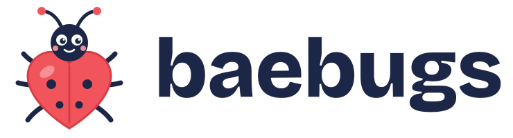

<p><picture><source media="(prefers-color-scheme: dark)" srcset="assets/brand/baebugs_logo_dark.svg"></picture></p>

# baebugs


## Submission (BioKEA Track A, Physical AI for Science Hack, Oct 25 2026)

| What | Where |
|---|---|
| **Every submitted link, one page** | [`docs/SUBMISSION_LINKS.md`](docs/SUBMISSION_LINKS.md) |
| End-to-end story page (7 steps, every number hashed) | [`site/story/`](site/story/) |
| Sieving robot (teammates: video, deck, arm code) | [`docs/sieving_robot/`](docs/sieving_robot/), [`filtration-robot/`](filtration-robot/) |
| **Demo video (YouTube)** | [https://youtu.be/O4Gq-r018cI](https://youtu.be/O4Gq-r018cI) |
| Demo reel (67 s, 7 steps, original music) | [`docs/demo/baebugs_reel.mp4`](docs/demo/baebugs_reel.mp4) |
| MVP graph page (root to leaf, check any hash, contest) | [`site/mvp/`](site/mvp/) · Protocol Board [`site/board/`](site/board/) |
| Training results, wins and nulls | [`docs/TRAINING_REVIEW.md`](docs/TRAINING_REVIEW.md) |
| Planned vs built (LOMO, Merkle break points) | [`docs/ASBUILT_LOMO.md`](docs/ASBUILT_LOMO.md) |
| Everything under custody (counts and roots) | [`kg/custody_inventory.json`](kg/custody_inventory.json) |
| Interchangeable filters (32 plates, 316L inserts, variable aperture) | [`print/filters/`](print/filters/), [`baebugs/inserts.py`](baebugs/inserts.py), [`baebugs/variable_aperture.py`](baebugs/variable_aperture.py) |
| Trommel print packages (BioKEA trays; Fuse 1+ zones + X1C rest) | [`print/packages/`](print/packages/) |
| Toy insects (91, STL + OpenSCAD + hash) | [`print/fuse1/`](print/fuse1/) |
| Vision at every step + escalation ladder | [`baebugs/tiers.py`](baebugs/tiers.py), [`baebugs/ladder.py`](baebugs/ladder.py), [`docs/ladder_demo/`](docs/ladder_demo/) |
| Bench asset database (35 objects, photos) | [`kg/assets.json`](kg/assets.json), [`assets/`](assets/) |
| Licensing | [`NOTICE.md`](NOTICE.md), [`docs/CLAIMS.md`](docs/CLAIMS.md) |

Code is MIT. Trained weights would be AGPL-3.0 (Ultralytics) and are not distributed here. Museum photos keep their CC0 / CC BY terms. See `NOTICE.md`.

## Human and AI review entry point

Start with the [workflow README](docs/workflow/README.md) for the current MVP scope, local demo instructions and evidence boundaries. AI reviewers: use the [review brief](docs/workflow/AI_REVIEW.md). The workflow page generates draft protocols; live inference and hardware execution are not connected to it. Older pipeline descriptions below describe architecture and must be checked against current receipts before treating them as observed runs.

**→ [Open the MVP graph](https://biobitworks.github.io/baebugs/site/mvp/)**: review the whole project from root to leaf, see what is claimed under which licence ([short version](docs/CLAIMS.md)), check any hash in your browser, and contest it. Agents: `npx github:biobitworks/baebugs get root` · `baebugs-graph get root` · MCP `python -m baebugs.graph_mcp`.

**Vision lane for BioKEA Track A, step 1 (BugSorter).** A USB camera looks at a preserved sample *before* it is sieved, measures every body in millimetres, and decides which sieves to stack and how hard to run the water. It then checks that plan against a digital twin of the bench and hands each sieve fraction to BugPicker in BugPicker's own file format. Every step is logged to a hash-chained provenance record.

Built at the Physical AI for Science Hack (Oct 24–25, 2026). The challenge is to make sample prep robust: "bags in, barcodes out".

```
 bag of specimens
      │
      ▼
 ① OBSERVE   AmScope/USB image ─► YOLO ┐
                                       ├─► consensus sizes (mm) ─► flag disagreements
             classical morphometrics ──┤        (+ optional Claude QA)
             BugPicker detector ───────┘
      │
      ▼
 ② HYPOTHESIZE  size classes ─► sieve stack (coarse→fine) + flow per sieve + water budget
      │
      ▼
 ③ PREFLIGHT   digital twin: sieve exists & free, order, slots, water above reserve
      │          (nothing reaches the arm / ESP32 sieve unless this is clean)
      ▼
 ④ RUN         partabot arm / BugSorter places sieves, water jets rinse
      │
      ▼
 ⑤ VERIFY      image each fraction ─► predicted vs observed ─► update retention margin
      │
      ▼
 ⑥ HAND OFF    manifest.jsonl / objects.jsonl with tray_size_class + sorting_tray_slot
               ─► BugDisperser ─► BugPicker ─► 96-well plate
      │
      ▼
   provenance.jsonl (hash-chained, verifiable per sample)
```

## Multi-tier tower, novel filters, robot emulation (new)

**Teammates: start with [`docs/HOWTO.md`](docs/HOWTO.md)** (requirements, install, every lane's commands).

- `tower_twin.py` + `config/tower.yaml`: wooden tower (storage face + filter face with a couple of active tiers
  over a catch tray). From the first spill photo, it picks which filter trays the Partabot arm mounts, then
  emulates the arm/rail run and fails closed on reach / order / occupancy / water. Geometry values are
  `MEASURE` placeholders until the tower is built.
- `punch_filters.py`: 31 hole types (craft punches, plastic canvas, tulle, **metal perforated / slotted / woven**,
  metal preferred for dead specimens), nominal sizes, Fuse plate STLs in `print/filters/`.
- `passage_twin.py`: every toy insect × every hole, over 64 orientations. Slots select by width lying flat;
  round holes need end-on passage.
- `notebooks/tower_twin.ipynb` replays the planner and the emulator with swappable `objects.jsonl`.

## Why each piece

| Piece | What it does | Why it matters for Track A |
|---|---|---|
| `measure.py` | Two independent sizers, YOLO and classical contours, paired by consensus | Their failure modes differ, so the arm only acts on sizes both agree on. Disagreements get flagged rather than sieved blind |
| `sieve.py` | Width classes mapped to the kit's actual frames, plus flow per mesh | The narrow axis decides what passes a mesh. Finer meshes get gentler flow so soft bodies aren't forced through |
| `sieve_calibrate.py` | Measures a mesh's real aperture from one backlit photo | Printed and woven meshes drift from their nominal size and warp. Measuring beats assuming |
| `twin.py` | Preflight in the style of Google's VERID (a digital twin of the lab) | Rejects plans that are physically invalid, such as a sieve already in use or too little water, before hardware moves |
| `method.py` | Predicted vs observed counts per fraction, then a retention-margin update | The sorter gets better each run instead of repeating the same error |
| `bugpicker_bridge.py` | Reads and writes [BugPicker](https://github.com/biokea/BugPicker)'s `manifest.jsonl` / `objects.jsonl` | Fills `tray_size_class` and `sorting_tray_slot`, so step 1 plugs into step 3 with no new protocol. It can also use BugPicker's detector as a measurement source |
| `calbug.py` | Pulls family composition for a locality from the Essig Museum / Calbug collection on GBIF (~550k records) and turns it into an expected size-class mix | Flags a bag that doesn't look like where it came from (wrong bag, broken specimens, debris) before sieving. Links provenance to `EMEC` catalog numbers |
| `fco.py` + `essig_adapter.py` | Each Essig source (home page, gaps page, label tool, GBIF record, label read from a photo by Claude) becomes a content-addressed FCO. They hybridize into a specimen-context FCO that logs which source supplied each field and every conflict | Grounds the vision model (prompt context, size prior), flags collection-gap taxa as novel, lists what is still missing. Home and gaps pages are read from browser-saved copies because robots.txt disallows fetching them |
| `novelty.py` + `preservation.py` + `materials.yaml` | Novel-size detection (k-NN density vs reference), mesh gaps in the stack, filter suggestions from nets to 63 µm nylon, ranked by how well they isolate the cluster and by part-level damage risk (wings, scales, legs, soft bodies) under each preservative | Selects for novelty without destroying the specimens that make it novel |
| `explore.py` | Filters × hardware × capture runs as Merkle leaves; root at every step = break point; LOMO per factor level; side-by-side verdict (robust / weak / disagree) | The mechanical scientific method: shows what actually improves, and when the evidence isn't there yet |
| `bugpicker_bridge.export_yolo` | BugPicker scans → YOLO dataset labelled by size class or family | Fast training: fine-tune YOLO on real trays in minutes |
| `provenance.py` | One hash-chained record per step | Covers what was done, to which sample, with which parameters, images and version, so the record is FAIR without a write-up afterwards |
| `mcp_server.py` | MCP tools: `measure_sample`, `plan_sieves`, `calibrate_sieve`, `sieve_inventory`, `trace_sample` | Gives the instrument an API, so an agent can run the protocol while people supervise |

## Kit (from the bench, `docs/bench/`)

| id | mesh | est. aperture | photo evidence |
|---|---|---|---|
| PERF-5 | perforated metal, round holes | ~5 mm | kept pasta, passed rice |
| GRID-4 | coarse printed plastic grid | ~4 mm | kept pasta and lasagna pieces |
| HEX-2 | hex wire | ~2.2 mm | most rice passed |
| SCREEN-1 | fine window screen | ~1.2 mm | kept rice, chia mostly passed |
| TRAY | solid catch tray | — | catches everything; hands off to BugDisperser |

These apertures are **estimates** read from the photos. Run calibration on a backlit top-down image of each mesh to replace them. Each frame has 6 cells, for replicates or separate samples.

## Quick start

```bash
pip install -e ".[notebook,dev]"          # add [yolo] and [claude] as needed
pytest -q
jupyter lab notebooks/baebugs_pipeline.ipynb          # main pipeline; swap data in the first cell
jupyter lab notebooks/essig_context_novelty.ipynb     # Essig FCO context + novelty/filter test case
jupyter lab notebooks/aok.ipynb                       # atoms of knowledge + licensing; swap REPO / AOK_JSON
jupyter lab notebooks/mvp_graph_pack.ipynb            # one graph pack, every surface same root; swap PACK / REPO
jupyter lab notebooks/compare_byo.ipynb               # Claude vs BYO break points; swap A / B
jupyter lab notebooks/watch_commit.ipynb              # watcher cycle in a scratch clone + receipt check
jupyter lab notebooks/taxon_crops_004.ipynb           # DAISY-BB-004 crops, thin-class flags, results + custody; swap RUN_DIR
baebugs analyze --image tray.jpg --px-per-mm 40          # or --camera 0 --aruco-mm 10
python -m baebugs.mcp_server                             # instrument as MCP server
```

**Scale.** Put a printed ArUco marker (4x4_50) of known size in the field of view and pass `--aruco-mm`. Otherwise measure px/mm once per zoom setting on the AmScope.

## Integration options for step 1 (pick one or stack them)

1. **Vision-first stack selection** (built). Image the sample, choose which frames go in the stack, run.
2. **Fixed stack + vision verification**. Always run all frames, then image each fraction. This gives QA and the retention-margin update, with the lowest risk on the day.
3. **Closed loop with the ESP32 BugSorter**. Implement `RobotAdapter.place_sieve` / `rinse` against the sieve's web UI (or a partabot arm), so `LabTwin.execute(..., dry_run=False)` drives the hardware.
4. **Feed BugPicker directly**. `write_scan()` produces a scan directory BugPicker already understands, with fractions labelled by measured size class.

## Still needed from the team

- Browser-saved copies of essigdb.berkeley.edu and /gaps.html → `essig_adapter.page_fco(..., saved_html_path=...)`
- Damage counts from real runs to fit `materials.yaml` fragility/abrasion placeholders (test-case outcomes are simulated)
- Family body-width ranges → `baebugs/config/family_sizes.yaml` (placeholders; drives the Essig prior)
- Real insect / analog size parameters → `baebugs/config/insects.yaml` (current values are placeholders)
- Measured apertures → `baebugs/config/sieves.yaml`
- YOLO weights trained on the nine bug analogs (BugPicker crops in `objects/` make a ready labelled set)
- ESP32 sieve endpoints / partabot SDK for `RobotAdapter`

## Licence

MIT

## Data sources

- [Essig Museum of Entomology](https://essigdb.berkeley.edu/query_specimens.html) / [Calbug](https://calbug.berkeley.edu/), via GBIF dataset `5d283bb6-64dd-4626-8b3b-a4e8db5415c3`
- [BioKEA BugPicker](https://github.com/biokea/BugPicker) file protocol
- Google Research, [VERID](https://research.google/blog/grounding-ai-agents-in-biological-reality-building-blocks-for-autonomous-wet-labs/) (digital-twin preflight pattern)

## Source-backed bounding-box viewer

[Inspect recorded YOLOE and OWLv2 boxes on photographed printed insect toys](https://baebugs-lab-workcell.vercel.app/detection/). Model guesses, not verified species IDs or live robotic recovery.
