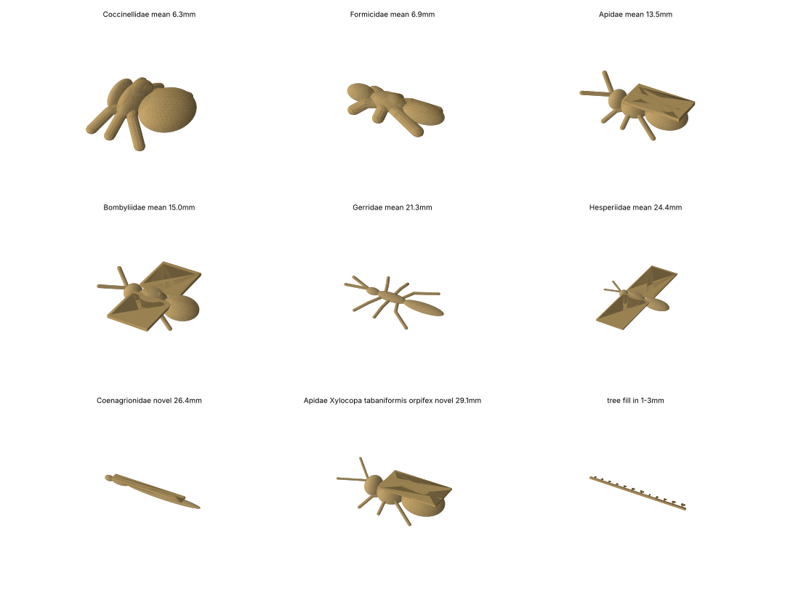

# baebugs TOY insect print set — Formlabs Fuse 1+ 30W (Nylon 12)

> **These are toys, not replicas.** Every model is a parametric stand-in (ellipsoid body
> segments, 0.8 mm rod legs/antennae, flat 0.8 mm plate wings) sized from database
> statistics. They are not anatomically accurate and not validated size standards.
> Use them for handling, sieve-stack and vision-pipeline tests only. Every row in
> `manifest.csv` and every specimen node in `kg/` carries `representation = toy`,
> plus a `size_flag`: `database-derived, unverified`, `fill-in size, not measured`, or
> `suspect: ...` where the length disagrees with typical published body lengths
> (Hesperiidae, Gerridae, Halictidae, Bombyliidae means; *Bombus mixtus*, *Andrena prunorum*,
> *Xylocopa t. orpifex*, *Epicauta fortis*). Suspect sizes are flagged, not corrected.

91 watertight toy insect STLs (1–30 mm) + 2 breakaway trees, generated by
`python -m baebugs.printmodels print/fuse1` (`baebugs/printmodels.py`).
Purpose: physical size standards for the BugSorter step-1 sieve stack
(PERF-5 / GRID-4 / HEX-2 / SCREEN-1 / TRAY) and the vision lane's size/novelty triage.

| folder | n | what |
|---|---|---|
| `california/` | 67 | 14 CA families × mean −2…+2 SD (clamped to 1–30 mm) |
| `novel_outside_ca/` | 12 | families/specimens from outside CA (AZ, NV, OR…) or >2 SD from their CA family |
| `fill_in_1-3mm/` | 12 | thrips-, aphid-, small-beetle-like bodies 1–3 mm — **below the database minimum (2.8 mm), not measured** |
| `trees/` | 2 | sprue rails holding the small parts (sub-6 mm and 1–3 mm) |
| `manifest.csv` | — | per model: family, SD level, body plan, length/width/height, bbox, features, watertight, volume, **kit tray**, size source |

Kit tray distribution (by body width vs. sieve aperture, `config/insects.yaml`):
HEX-2 28 · PERF-5 26 · SCREEN-1 16 · TRAY 11 · GRID-4 10.

## Size provenance
- **California set**: family length mean ± SD from ruler-scaled museum specimen photos
  (2,398 CA specimens; L 13.2 ± 5.6 mm, range 2.8–29.8 mm). Families with n ≥ 15:
  Coccinellidae, Formicidae, Melittidae, Andrenidae, Halictidae, Syrphidae, Meloidae,
  Largidae, Vespidae, Apidae, Bombyliidae, Gerridae, Hesperiidae, Cicadidae.
- **Novel set**: 231 outside-CA specimens; Coenagrionidae and Elachistidae have no CA records
  (made at mean and ±1 SD); six individuals are >2 SD from their CA family
  (e.g. *Xylocopa* 29.1 mm, *Bombus mixtus* 28.2 mm, *Epicauta fortis* 2.1 mm, *Perdita* 3.6 mm).
- Museum widths include spread wings/legs, so **body width comes from the body plan**, not the
  measured envelope. Length is the body length; antennae/wings can extend the bbox beyond 30 mm
  (e.g. Hesperiidae with spread wings).

## Fuse 1+ design rules applied
- Legs/antennae Ø ≥ 0.8 mm (legs only if L ≥ 6 mm, antennae if L ≥ 12 mm); wings are 0.8 mm plates (L ≥ 8 mm).
- Walls ≥ 0.6 mm; all parts unioned (manifold3d) and verified watertight.
- Parts < 6 mm ship on breakaway trees (0.8 mm sprues, 5 mm spacing) so they survive depowdering.
- Pack with ≥ 5 mm spacing; Nylon 12, default 0.11 mm layer.

## Licensing
These are original parametric models (repo license). Not included: Free3D "printable insects"
(Personal Use licence, cannot be redistributed) and scAnt/Sketchfab scans (CC BY 4.0 — can be
added with attribution once downloaded and rescaled to the database sizes).

## Merkle knowledge graph (`kg/`) and held-out tests (`kg/lomo/`)
Each toy is a Merkle tree: primitive → part → tagma → insect (the **insect hash**,
deterministic: rebuilt from length + body plan it reproduces bit-for-bit on Linux and macOS)
→ specimen (provenance + `representation: toy`) → family → group → collection root.
Logic checks at each level (Fuse minimums, containment, monotone bounding boxes, union volume,
attachment, mirror symmetry, tagma order, body span, counts, tray) are hashed in, so a failed
check is a break point. 13 of the smallest toys fail `fuse_minimum` (body segments under 0.6 mm).
`python -m baebugs.insect_kg --ledger` rebuilds it; `python -m baebugs.insect_lomo` runs
leave-one-model-out / leave-one-family-out with a logic → local model → Claude → human cascade.

## OpenSCAD
`scad/<toy>.scad` (one per STL, exact primitives; rods as hulled spheres) + `scad/toy_lib.scad`. The STL stays canonical (Merkle insect hash); the .scad is the editable equivalent. Regenerate: `python -m baebugs.scad_export`.
