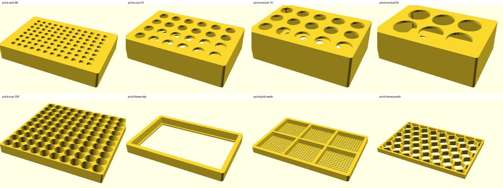

# Labware twin (v0.1, 2026-10-25)

Nineteen pieces of bench labware from Byron's photos, remixed into eight printable parts with
Opentrons definitions and a Merkle chain of custody. Source: `baebugs/labware_twin.py`.
Replay: `notebooks/labware_twin.ipynb`.



**All observed dimensions are estimates** from photos against an 18 in steel rule (`est: true` in
`catalog.json`). The SBS footprint (127.76 × 85.48 mm) and 9 mm 96-well pitch are standards. Check
with calipers before a production print. Vendor names and marks are left out on purpose.

```bash
python -m baebugs.labware_twin                 # rebuild (needs openscad + trimesh), then verify
python -m baebugs.labware_twin --verify-only   # re-hash every fragment, proof, file and the custody log
```

| Path | What |
|---|---|
| `scad/labware.scad` | Library: `sbs_plate`, `grid_insert`, `frame`, `grid_frame`, `honeycomb` (2D profiles, fast) |
| `scad/print-*.scad` | One file per remix; edit the numbers and re-render |
| `stl/` | OpenSCAD 2021.01 renders stored as binary STL, all watertight |
| `opentrons/` | Labware defs, schema v2, validated against `opentrons-shared-data`. Not in `opentrons/labware/` yet: well depths are estimates. |
| `merkle/parts.json` | Every fragment with payload, leaf and inclusion proof |
| `merkle/lab_root.json`, `custody_log.json` | Lab root over part roots; hash-linked events captured → cataloged → modeled → sealed |
| `merkle/breaks.json` | The 16 source photos: hashes pinned, bytes off-repo (they show vendor marks), so each is a BREAK |

## Hash rules
Canonical JSON (sorted keys, no whitespace, UTF-8, integral floats as ints). Leaf =
sha256(`0x00` ‖ name ‖ `\n` ‖ json). Node = sha256(`0x01` ‖ L ‖ R), odd node carried up. Fragments
sorted by name. A remix's `derivation` fragment holds the roots of the observed parts it came from.

## Remixes (filament at 75 % fill, 2026 retail estimates)

| Part | Footprint | Material | ≈ g | ≈ USD | Opentrons loadName |
|---|---|---|---|---|---|
| SBS 96 rack, 9 mm pitch | SBS | PETG | 50 | 1.11 | `baebugs_rack_96` (tube rack, not a tip rack) |
| SBS 4×6 rack, 2 mL cryotubes | SBS | PETG | 56 | 1.23 | `baebugs_cryo_24` |
| SBS 3×5 rack, 15 mL | SBS | PETG | 63 | 1.38 | `baebugs_conical_15` |
| SBS 2×3 rack, 50 mL | SBS | PETG | 61 | 1.35 | `baebugs_conical_50` |
| 10×10 cryo grid insert | 133 mm | PP | 43 | 1.93 | — (not an SBS slot) |
| SBS lipped frame ("folder") | SBS | PETG | 25 | 0.54 | — |
| SBS 2×3 screened grid frame | SBS | PETG | 24 | 0.54 | — |
| Honeycomb insert | fits frame | PLA | 14 | 0.28 | — |

Full set ≈ 336 g, ≈ $8.40. With a 1 kg PETG spool (~$22) and calipers (~$25) the kit stays under $200,
assuming a printer is on hand.

## Manufacturing risk
- **Cryo grid webs:** the 133 mm grid is pitch-bound (13 mm); holes are 12.6 mm, leaving 0.4 mm webs (one nozzle line) and ~0.1 mm clearance over the estimated tube OD. Measure tubes first.
- **Cold:** printed PLA/PETG crack below about −20 °C. Keep the molded cryo box for −80 °C / LN2.
- **Heat/sterility:** PLA softens near 55 °C; no printed part is autoclavable or sterile.
- **Robot tolerance:** tip pickup needs ~0.1 mm seating; use vendor tip racks on the robot.
- **Calibration:** well depths are estimates; run Labware Position Check before any liquid step.
- **Never print** tube substitutes, centrifuge rotors or anything that spins.

## Knowledge-ownership risk
- **Trademarks:** brand names and logos stay out of every file and render; describe compatibility in words only.
- **Design rights:** copy function, not form (SBS footprint, 9 mm pitch, measured tube diameters). Skip distinctive insert spines and 4-way cube interlocks.
- **Standards:** ANSI/SLAS 1-2004 footprint dimensions are free to use.
- **Licence:** MIT, like everything else written in this repo (see `docs/CLAIMS.md`). CERN-OHL-W/S would be the hardware-specific alternative if the repo ever adopts it; that is a repo-wide call, not a per-folder one.
