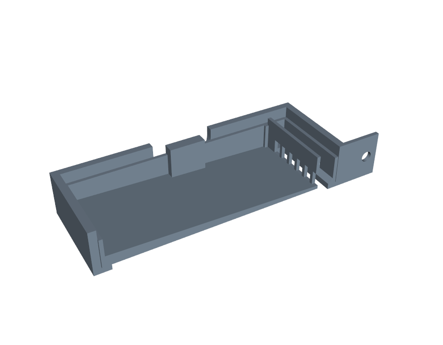
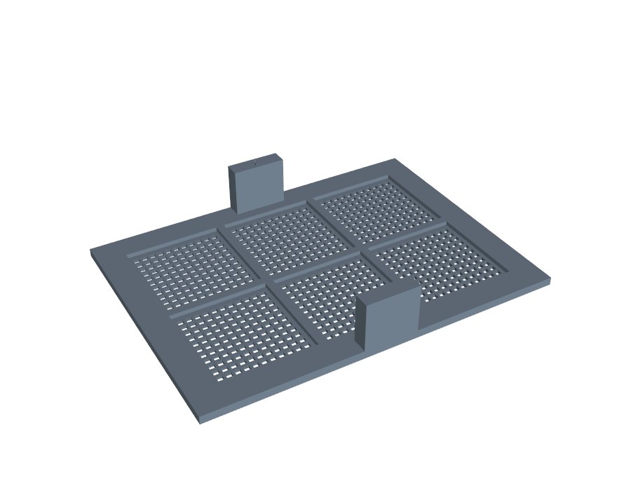
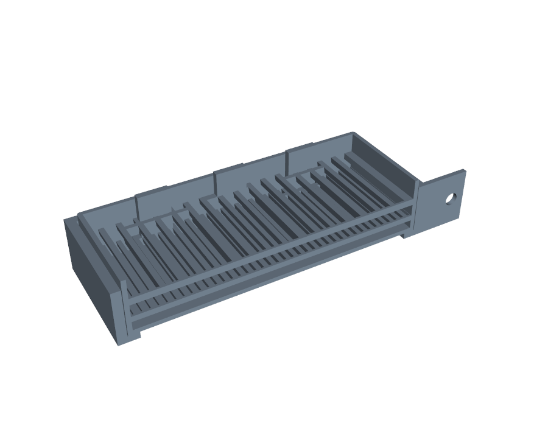
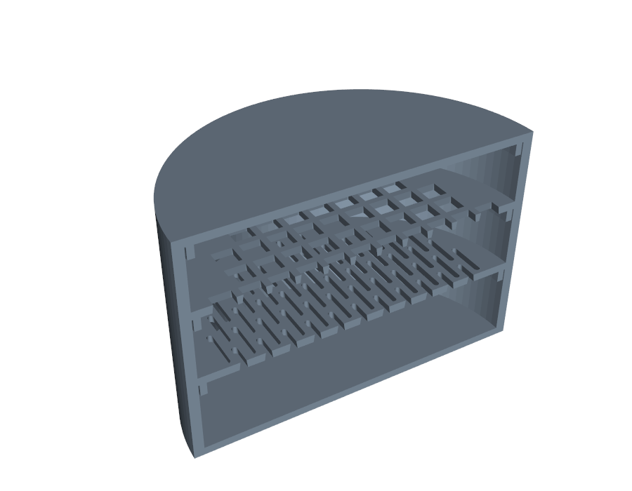

<p align="center">
  
</p>

<h1 align="center">testSieveSorter</h1>

<p align="center"><b>Break up a Malaise clump, then sort the insects by size, using printed sieves designed in simulation.</b></p>

Hackathon work on BioKEA's **BugSorter**, the size-sorting module at the front of their insect barcoding line.

## Hackathon

[**Physical AI for Science Hack @ Studio 45 with Claude Community**](https://luma.com/3vc5oeit), Studio 45, San Francisco, Oct 24–25, 2026. Hosted by SF AI Science Studio. Registered as Aufstin Filiko on the ajfiliko account.

- **Track:** BioKEA, environmental sample prep (Track A). BioKEA is a Berkeley wet lab doing DNA barcoding, eDNA and long-read genomics. The brief: learn their soil and water prep workflow for imaging and sequencing, then make it faster or more reliable.
- **Other tracks:** Opentrons Flex, and an open hardware challenge (a tool someone else could build for under $200).
- **Deadlines:** final submission Sun Oct 25 at 2:30 PM PT; live demos 3:30–4:30 PM, then demos and pitching 4:30–5:30 PM.

> **How the system works, in one page:** [docs/SYSTEM.md](docs/SYSTEM.md). That's the shared description every work stream follows.

## The real problem: the sample arrives as a clump

Malaise-trap samples are thousands of mostly tiny flies in ethanol. They often arrive as a **compacted ball or mound of insects**, tangled together and mixed with **leaves, twigs and dirt**. Sieves can only sort specimens that are already loose. So the input to this system is a clump, and its first and most important job is to **break that clump apart gently**: no crushed specimens and no snapped legs, because everything goes on to imaging and DNA barcoding. Only then does it sort by size.

The design for that is a **breaker layer** on top of the sorting stack: a printed grid with blunt pins, plus the rig's shake and spray jets. The grid lets freed specimens through and holds the leaves back. The sim models the clump as specimens held together by breakable bonds that weaken when wet, and the design optimizer searches breaker shapes and shake directions for the fastest, gentlest break-up. Brief: [docs/sessions/clump-breakup.md](docs/sessions/clump-breakup.md).

## What this builds on: BioKEA's BugSorter

[BioKEA/BugSorter](https://github.com/BioKEA/BugSorter) is BioKEA's upgrade of the [EntoSieve](https://pubmed.ncbi.nlm.nih.gov/40066677/) automated bug sorter. The original EntoSieve used custom Arduino electronics with analog controls. BugSorter replaces them with an ESP32 (an [M5Stack Core](https://shop.m5stack.com/products/esp32-basic-core-lot-development-kit-v2-7) plus the [M5Stack stepper module](https://shop.m5stack.com/products/stepmotor-driver-module-v1-1-hr8825)), built with PlatformIO. It joins the lab Wi-Fi and serves a web app that sets homing, the top and bottom positions, speed and sieving-cycle duration, and saves those settings. The M5Stack's screen and buttons give local, manual control.

BugSorter changes the electronics and control, not the sieving itself: insects still sort by size through a stack of mesh inserts in a holder tower that the stepper shakes. This repo works on that sieving side:
- **`cad/`:** printable replacements for the glued-mesh inserts (printed sieves, plinko layers, and the gated container), sized to drop into BugSorter's existing holder.
- **`sim/`:** a MuJoCo model of the tower, for ranking designs before printing. It covers the per-level seesaw, the firmware's constant-speed stroke and vibration, clumps of specimens with breakable bonds, and debris.

## How it works

1. **Break up the clump.**
   - A printed **breaker layer** sits on top of the stack: an 8 mm grid with 77 blunt pins (`cad/breaker_layer.py`, 89 min on the P1S). It works with the rig's motion and spray.
   - In the sim (`sim/clumps.py`), a clump is specimens held together by bonds that snap under load and weaken when wet, with leaves, twigs and dirt mixed in. It's measured by how fast specimens come free, the largest piece left, and how hard each specimen gets hit.
2. **Sort on a seesawing stack.**
   - **Separate trays, one above the other:** coarse on top, finer below, a catch pan at the bottom.
   - **Each tray seesaws** about its own pivot across its middle, so its ends tip up and down, and **neighbouring trays rock in opposite directions**. Whatever falls from one level lands on a tray tilted the other way.
   - Sim: `sim/rocking.py`. CAD: `cad/seesaw_holder.py`, the ribs-across inserts in `cad/sieve_insert.py`, and the lipped catch pan.
3. **Let the simulation design the parts.**
   - `sim/optimize.py` proposes printable variants, runs each across 3 friction sets × 3 seeds, and ranks them by the worst class's purity and recovery.
   - It writes down why the losers failed (`sim/opt/LOG.md`) and adds new design families when parameters run out.
   - The winners are built and sliced for the P1S (`cad/winners.py`, `sim/opt/print_plan.md`).
4. **Keep the numbers honest.** The sim ranks designs; it doesn't predict real percentages until it's calibrated against bench counts (`sim/BENCH.md`).

The one-page system description is [docs/SYSTEM.md](docs/SYSTEM.md), the work plan is [docs/sessions/PLAN.md](docs/sessions/PLAN.md), and the 5-minute demo script is [docs/PITCH.md](docs/PITCH.md).

## Results (MuJoCo sim, uncalibrated)

Watch the replays in the **Sieve Render Lab**: 30 runs from all five sessions in the one viewer, chosen from a Run menu in its options panel (published privately; share it from its Share menu). Rebuild it with `sim/render_site/build_site.py`, which reads the run list in `sim/render_site/runs_def.py`. The sim **ranks** designs; it doesn't predict real percentages until it's calibrated against bench counts.

**1. A clump that holds together, and a breaker that frees it.** The clump is 35 Malaise-size insects (2–6 mm and over 6 mm) with a leaf, a twig and dirt, held by 155 medium bonds:

| Top level | Freed | Half / 90% freed by | Largest piece left |
|---|---|---|---|
| No breaker, ±10° seesaw | **9%** | never | 32 of 35 |
| **Optimizer's breaker** B-164f355a + buzz + spray, ±7° seesaw | **100%** | 3.5 s / 5.0 s | 1 |

With the real Malaise size mix (57% under 1.5 mm), the default breaker + buzz frees 35% with the spray off and 60% with it on, still rising at 4 s (`sim/CLUMPS.md`). **The breaker and the buzz do the breaking, and the spray finishes it.**

**2. The system designed that breaker** (`sim/opt/leaderboard_malaise.md`, EXPLORATORY, grain-surrogate clump, weak / medium / strong bonds, **checked on freshly packed clumps**):

| Breaker (prints as is with `cad/breaker_layer.py`) | Motion | Score | Freed (fresh clumps) |
|---|---|---|---|
| **B-164f355a**: 11.3 mm grid, round pins 3.1 × 8 mm | ±7°, 1.1 s + 0.35 mm 40 Hz buzz | **0.630** | **94%** |
| B-87f42099: 8.9 mm grid, flat pins 2 × 7.6 mm | ±8°, 3.5 s + 0.35 mm buzz | 0.605 | 94% |
| CAD default (8 mm grid, 2.5 × 12 mm pins) + buzz | ±10°, 2 s + 0.3 mm | 0.452 | 84% |
| CAD default, no buzz | ±10°, 2 s | 0.216 | 34% |
| No breaker | ±10°, 2 s | 0.229 | 48% |

Round 2's apparent leader (0.700) fell to 0.42 on fresh clumps, so winners must now pass that check. Short pins (6–8 mm) beat the hand-picked 12 mm. **B-164f355a is sliced for the P1S: 57 min, 19.6 g** (`sim/opt/print_plan_malaise.md`).

**3. Sorting on the seesaw: before and after the fixes the sim found.** 125 grains of all 10 modelled kinds, ±10° alternating seesaw, 12 s:

| Where grains ended | Before: old inserts, 85 mm apart, seesaw only | After: ribs-across inserts, centre-pivot holder 55 mm apart, + 0.3 mm 40 Hz buzz |
|---|---|---|
| Pasta, chickpea on 5 mm | 15 / 15 | 15 / 15 |
| Quinoa, couscous, chia in the catch | 30 / 45 (12 stuck on the 5 mm ribs) | **44 / 45** |
| Black and wild rice on 2 mm | 16 / 22 | 20 / 22 |
| Plain and white rice on 2 mm | 11 / 24 | 1 / 24 (the buzz shakes them through) |

The fixes came from the sim:
- grains rode ribs that ran along the tilt, which gave the **ribs-across inserts**;
- a gentle seesaw is below the ~22° slide angle, which gave **the buzz**;
- the drops between levels hit specimens hardest, which gave **the centre-pivot holder**, about half the drop.

The buzz trades plain-rice retention for clearing the fine grains. Tune its amplitude on the bench.

**4. Sorting on the seesaw, designed by the optimizer** (`sim/opt/leaderboard_seesaw.md`, alternating seesaw, ends tip):

| Design | Motion | Score |
|---|---|---|
| **Plinko rods 4.7 / 1.5 mm** (one box, three layers) | ±14°, 1.9 s + 0.35 mm 40 Hz buzz | **0.998**: every class 100% pure and recovered, t90 0.6 s |
| Plinko rods 4.5 / 1.4 mm | ±10.5°, 1.5 s + 0.2 mm buzz | 0.997 |
| Best separate-trays design (inserts 5.2 / 1.8 mm) | + buzz | 0.63 |
| Seesaw alone, best of any design | no buzz | 0.345 |

The buzz is what makes the seesaw sort. With separate 5 / 2 mm trays the buzz also pushes rice through 2 mm, while rod layers keep the classes clean.

**5. The ramp gated tower on the seesaw, with the precise fast shake** (main session, 13:58). The optimizer's mid-slot gated tower with the 30° ramp (G-a1ecf9bb) rocks as one piece ±10° about its middle, with a 0.4 mm, 48 Hz shake thrown 30° up on top:
- Its own 4-grain mix: pasta 8/8 and chickpea 8/8 on L1, rice 27/30 on L2, quinoa 29/30 in the catch.
- **All 10 grains:** pasta and chickpea 100% on L1. **Plain rice 12/12 on L2:** the gates keep the rice that the 2 mm sieve lets through. White rice 10/12 and brown 11/12 on L2. Chia 14/15, quinoa 12/15 and couscous 11/15 in the catch. Black and wild rice partly stay on L1.
- The standard flipped gated tower stalls the fines on L2 (0/15 quinoa and chia reach the catch). Flipped levels don't suit a symmetric seesaw; the mid-slot ramp layout does.
- Run with `sim/render_site/run_onebox.py` (the optimizer's one-box seesaw patch) and `--stroke seesaw:deg=10,period_s=2,vib_mm=0.4,vib_hz=48,vib_angle_deg=30`.

**6. What the optimizer learned along the way** (`sim/opt/LOG.md`):
- On a symmetric seesaw, gated containers can't sort at all, and plinko rods are the only style that does.
- On a vibrating-tool shake, plinko rod layers sort the demo grains at about 100%, against 0.52 for today's glued mesh.

**Bench prototype** (Forum's photos): a printed 5 mm square-grid tray on a handheld DeWalt 20V MAX tool, sorting ditalini from rice. The photos are kept locally (`media/`).

The earlier verdict on gates ([docs/gates-verdict.md](docs/gates-verdict.md)) predates the seesaw.

## Repository layout

| Folder | What's in it |
|---|---|
| [`cad/`](cad/) | CadQuery scripts for every printable part. Previews (`out/*.png`) and checks (`out/*_checks.json`) are committed; STL, STEP and sliced files are rebuilt, not committed. Details below. |
| [`sim/`](sim/) | MuJoCo sorter simulation, parameter sweeps, calibration against bench counts, and a three.js replay viewer. See [sim/README.md](sim/README.md) and the bench protocol in [sim/BENCH.md](sim/BENCH.md). |
| [`docs/`](docs/) | Design verdicts, the source-linked comparison with BioKEA's system, reviewer briefs and answers. |
| [`docs/sessions/`](docs/sessions/) | Briefs for the parallel work streams: CAD and Bambu, physics, and the design optimizer. |
| [`pi/`](pi/) | Raspberry Pi helper script (`buzz.py`). |
| [`.claude/skills/sieve-gate-design/`](.claude/skills/sieve-gate-design/) | A Claude Code skill: from a sample spec to tested gate sizes, printable strips, a sim check and a logged iteration. |

## Running the code

Python 3.12. Dependencies are in [requirements.txt](requirements.txt).

- **MuJoCo and CadQuery run in WSL2 (Ubuntu).** On the Windows dev laptop, Smart App Control blocks the unsigned native DLLs in `mujoco`, `cadquery` and `vtk`. The shared venv lives at `~/venvs/sieve`:
  ```
  uv venv ~/venvs/sieve --python 3.12
  uv pip install --python ~/venvs/sieve/bin/python -r requirements.txt
  ```
- **Windows `.venv`** (repo root): numpy and trimesh only. That's enough for `sim/viewer.py`, which builds the replay pages. `cad/slice.py` calls Bambu Studio, which is installed on Windows.
- Run each script from its own folder: `cad/` for parts, `sim/` for the sim. For example:
  ```
  cd sim
  python sorter.py --design pool:w5p0,t1p4 --mix rice=30,quinoa=30,chickpea=8,pasta=8 --stroke sine:amp_mm=3,freq_hz=10 --duration 10 --out out/runs/demo
  python viewer.py out/runs/demo --open
  ```

## Docs

| File | What it is |
|---|---|
| [docs/gates-verdict.md](docs/gates-verdict.md) | Verdict on the gates idea, how to make the back-and-forth work, the three-hour build, tests, scoring, and where the three reviewers (Claude, Fable 5.1, Codex Astra) agreed and disagreed |
| [docs/current-system-vs-our-idea.md](docs/current-system-vs-our-idea.md) | BioKEA's current system, with a source link on every claim, side by side with our idea, plus questions to check on the bench |
| [docs/codex-astra-brief.md](docs/codex-astra-brief.md) | The question sent to Codex Astra |
| [docs/codex-astra-answer.md](docs/codex-astra-answer.md) | Codex Astra's answer, verbatim |
| [docs/bugsorter-line-breakdown.html](docs/bugsorter-line-breakdown.html) | Earlier report: all five modules and the BugSorter-to-BugDisperser handoff. Its pantry stand-ins (chia, couscous, noodles) predate the switch to rice, pasta and quinoa. |
| [sim/README.md](sim/README.md) | How the sim works: engine, shaking, geometry, contacts, and what each file does |
| [sim/opt/leaderboard.md](sim/opt/leaderboard.md) | The design optimizer's ranking: top 10, best of each family, the fixed references (including the stacked demo rig) and a stress test. [winners.json](sim/opt/winners.json) has the top 3 with CAD parameters, and [LOG.md](sim/opt/LOG.md) has each round's reading and next hypothesis. Sim ranks only; uncalibrated |
| [sim/VERTICAL.md](sim/VERTICAL.md) | Up-and-down vs angled vs along-the-tray shaking, on one tray and on the stacked rig; contact settings for vertical strokes |
| [sim/PERF.md](sim/PERF.md) | Sim speed on this laptop (WSL), worker scaling, chosen solver defaults |
| [sim/BENCH.md](sim/BENCH.md) | What to measure on the bench, and which CSV template each number goes in |
| [cad/WORKING_DIMENSIONS.md](cad/WORKING_DIMENSIONS.md) | Current holder and insert dimensions |
| [docs/sessions/](docs/sessions/) | Work-stream briefs: [**clump break-up (top priority)**](docs/sessions/clump-breakup.md), [CAD and Bambu](docs/sessions/bambu.md), [physics](docs/sessions/physics.md), [design optimizer](docs/sessions/design-optimizer.md), [demo rig and up-and-down shaking](docs/sessions/demo-rig.md), [physics handoff](docs/sessions/physics-handoff.md) |

## Key sources

- Track A deck: https://docs.google.com/presentation/d/1SxKytbrSBqIaxMuh4jCn2J_zIUmfZpnH/preview
- BugSorter firmware: https://github.com/BioKEA/BugSorter
- BugPicker: https://github.com/BioKEA/BugPicker
- EntoSieve paper: https://pmc.ncbi.nlm.nih.gov/articles/PMC12225705/ (build files: https://osf.io/6t25n/)
- Elbrecht et al. 2021, wet sieving: https://pmc.ncbi.nlm.nih.gov/articles/PMC8500090

## Sieve system CAD (`cad/`)

Every part is exactly the size of a 24-well plate (127.76 × 85.47 × 20.27 mm), so it drops into any plate holder, plate shaker or plate gripper. A 3 mm lip under each part nests into the part below. The lip sits inside the 20.27 mm height.

**Stack, top to bottom:**

| Part | What it does |
|---|---|
| `lid` | Keeps grains from bouncing out |
| `tray_coarse_5p0` | 5.0 mm round holes. Pasta stays on top; rice and quinoa pass. |
| `tray_fine_2p3` | 2.3 mm round holes, for short-grain rice vs. quinoa |
| `tray_fine_slot_1p3` | 1.3 × 12 mm slots, which sort by thickness. Use this one for long-grain rice vs. quinoa. |
| `collector` | Sealed bin for whatever passes the fine tray (about 177 mL) |

**Also:**

| Part | What it does |
|---|---|
| `tray_open` + `clamp_ring` | Frame for a 121.2 × 78.9 mm piece cut from the kit's metal sheets. Clip the corners, drop it on the ledge, press the ring on top. |
| `tier_coarse` + `tier_fine` | Tiered concentric sorter that sits in `collector` (see **Tiered sorter** below). Built by `tiered_sorter.py`. |
| `gate_coupon_2p3`, `gate_coupon_5p0` | The gates idea, to run beside a perforated tray. Grains start on a raised deck, pass between tapered posts, and drop 5 mm into a pocket. Shake along the long side. |
| `pool` + gate strips | One open plane, shaken along the long side, with swappable gates (see **Pool sorter** below). P1S estimate: 58 min, 44 g. |
| `pool_coupon` | One gate slot of the pool (46 mm long), to check the strip fit and gate behaviour before printing the pool. 29 min. |

### Working dimensions

The holder box and sieve inserts are the current working design. The numbers are listed in [cad/WORKING_DIMENSIONS.md](cad/WORKING_DIMENSIONS.md).

**Opening in Bambu Studio:** every STL is a separate part, centred on the same origin.
- If Bambu Studio asks whether to load several files as a single object, click **No**, then press **A** (Arrange) to lay them out.
- Clicking **Yes** stacks the parts on top of each other in one spot.

### Gated container: the final design (`gated_container.py`)



A drop-in replacement for the mesh inserts in the BugSorter tower: same 131.4 × 95.4 mm footprint and the same pull tabs, shaken longways. The tabs stop 1 mm under the box rim so the boxes stack rim on rim; grip them through the box's finger notches.

**How it sorts:**
1. The floor is solid and slopes 2° toward a gate strip at the +X end. Shaking walks grains, and the spray water, down to the gate.
2. Anything that fits through the gate drops through the slot just past it, over the box's open bottom, onto the next level. It can't come back.
3. Anything too big stays in the container. Lift it out by the tabs and put it in the pool.

**Gate strips** slide into rails and swap out, so you can change the cut without reprinting the container. They print flat (about 7 min each), which puts the gap width and tunnel height in the printer's accurate XY plane.

| Strip | Openings | Cuts by |
|---|---|---|
| `gate_w5p0`, `gate_w3p0`, `gate_w2p0` | Width gaps 5.0 / 3.0 / 2.0 mm, 8 mm tall | The narrower side of a flat-lying grain |
| `gate_t1p2`, `gate_t1p4`, `gate_t1p6` | Tunnels 8 mm wide, 1.2 / 1.4 / 1.6 mm tall | Thickness. Long-grain rice (~1.7 mm) stays; quinoa (~1.0 mm) passes. |

**In the tower, flip the container 180° on every other level.** That way, what drops from the level above lands on the solid end of the next container instead of falling straight through its slot.


Dimensions are in [cad/WORKING_DIMENSIONS.md](cad/WORKING_DIMENSIONS.md).

### Sieve inserts for the holder box (`sieve_insert.py`)



Printable versions of BioKEA's flat 2×3-window inserts with pull tabs, with the mesh printed in as square holes instead of glued on.

| Part | Holes | Bars | Screen thickness |
|---|---|---|---|
| `sieve_insert_5mm` | 150 holes, 5.0 mm square | 1.2 mm | 1.6 mm |
| `sieve_insert_2mm` | 726 holes, 2.0 mm square | 1.0 mm | 1.4 mm |

**Shape:**
- Insert 131.4 × 95.4 mm, frame 3 mm thick
- Border 10 mm, ribs 3 mm, six windows of 35.1 × 36.2 mm
- Two pull tabs, 20 × 6 mm and 18 mm tall, in the middle of the long edges; the hole size is debossed on one tab's top

**Printing:**
- The screen sits at the bottom of each window, on the print bed, so it prints without bridging. It ends up 1.4–1.6 mm below the frame's top surface; glued mesh sat on top.
- Holes widen 8° downward so near-size grains fall free.
- Flat, right side up, no supports.

**Sizes:** measure an existing insert and correct `BORDER`, `RIB`, `FRAME_T` and the tab sizes. The outside size follows the `frame_holder.py` pocket.

### Plinko layers for the frame holder box (`plinko_layers.py`)



Drop-in layers that replace the glued-mesh inserts in BioKEA's box (`frame_holder.py`). All three stack inside one box. Load on top, shake along the box's long side (X), and spray from above as usual.

| Layer | Floor | Keeps | Pull tabs |
|---|---|---|---|
| `layer_1_rods_5p0` (top) | 16 rods, gap 5.0 mm | Pasta | x = 0 |
| `layer_2_rods_1p4` | 37 rods, gap 1.4 mm | Long-grain rice (~1.7 mm thick) | x = −35 |
| `layer_3_catch` (on the ledge) | Solid | Quinoa | x = +35 |

**How it sorts:**
- Rods run across the box, perpendicular to the shake, so grains hop across them and tip into the gaps.
- A flat grain that tips into a gap is sorted by its thickness, which is what splits long-grain rice from quinoa.
- Rods narrow 8° downward, so a grain that gets in falls free instead of wedging.

**Unloading:**
- Lift the layers out top-down: pasta, then rice, then quinoa.
- Each layer is a walled tray, so it keeps its catch while you lift it. It can go straight into the water pool, like the current mesh filters.
- Every layer's tabs stand 6 mm above the box rim. Lower layers' tabs pass through 0.3 mm-clearance slots in the layers above.

**Sizes:** layers are 131.4 × 95.4 mm (the frame holder's guessed 132 × 96 mm pocket, minus 0.6 mm clearance). Measure the real box, then change `WALL` and `LEDGE_T` in `frame_holder.py`; the layers follow. Change gaps and heights in `LAYERS`.

### Round layer stack (`round_stack.py`)



Full layers, all the same size (85 mm across, 20.27 mm tall), with the gates in each floor. Anything smaller than a layer's gates falls through to the layer below. Each layer's lip nests into the rim of the one below, and each layer lifts off carrying its own class.

| Part | Gates | Keeps | Passes |
|---|---|---|---|
| `round_lid` | — | — | — |
| `layer_x_square_5p0` | 73 square, 5.0 mm | Pasta | Rice, quinoa |
| `layer_y_slot_1p4` | 95 slots, 1.4 × 10 mm | Long-grain rice (~1.7 mm thick) | Quinoa (~1.0 mm thick) |
| `layer_y_square_2p3` | 261 square, 2.3 mm | Short-grain rice | Quinoa (swap in instead of the slot layer if your rice is short-grain) |
| `round_collector` | — | Quinoa | — |

- **Square gates** sort by width. **Slots** sort by thickness: shaking tips grains edge-first into a floor slot, the way grain graders sort barley.
- Every gate widens 8° downward, so near-size grains fall free.
- Prints flat, right side up, no supports. Rebuild with `round_stack.py` and change sizes in `LAYERS`.

### Tiered sorter


Circles with gates on separate tiers: a small coarse tier sits on a bigger fine tier, which sits in the plate-sized `collector`. Load the mix on top of the coarse tier and shake.

**The physics it relies on:**
- **Push.** Each tier's floor is a 10° cone, high in the middle. Still, nothing slides: rice on plastic needs about 22°. Shaking at roughly 0.2–0.3 g makes grains flow downhill to the rim.
- **Gate shape.** Shaking lays grains flat, so each gate is a low tunnel at floor level. The tunnel's height sets the thickness cut and its width sets the width cut.
- **One-way.** Whatever passes a tunnel drops 8 mm onto the tier below and can't climb back.
- **Unloading.** Lift each tier off; it carries its own size class.

**Tiers, top to bottom:**

| Part | Size | Tunnels | Keeps | Passes |
|---|---|---|---|---|
| `tier_coarse` | 40 mm cone | 17 tunnels, 5.0 wide × 4.0 high | Tube pasta | Rice, quinoa |
| `tier_fine` | 66 mm cone | 34 tunnels, 4.0 wide × 1.4 high | Long-grain rice (~1.7 mm thick) | Quinoa (~1.0 mm thick) |
| `collector` | plate-sized bin | — | Quinoa | — |

**Fit.** A peg on `tier_fine` centres `tier_coarse`. Four feet centre `tier_fine` in the collector.

**Printing.** Each part prints flat on its base with no supports. Only the tunnel ceilings bridge, over 4–5 mm. Print at 0.2 mm layers so the 1.4 mm tunnels are exactly 7 layers.

**Caveats:**
- Keep pasta to about 10 short pieces (under 25 mm). The 40 mm top tier fills fast, and pasta lying against the rim covers tunnels.
- Flat pasta such as farfalle is thinner than 4 mm and will pass the coarse tier.

**Rebuild:** run `..\.venv\Scripts\python.exe tiered_sorter.py` from `cad\`. Change sizes in `TIERS` and `SLOPE_DEG`.

### Pool sorter


**Layout.** Load at the +X end. The floor steps down 3 mm at each gate toward the open -X end:

| Zone | Floor | Length |
|---|---|---|
| Load | z 8 | 45 mm |
| Middle | z 5 | 40 mm |
| End | z 2 | 34 mm |

The drop biases grains forward; it isn't a one-way valve. Each gate is a separate 2 mm strip that slides into grooves in the side walls and lifts out. A dam strip closes the open end.

**Strips.**
- Print them lying flat, so the gap width and tunnel height come out in the printer's accurate XY plane. They take 6 to 7 min each; put the whole set on one plate.
- Any gate fits either gate slot.
- Width gates cut by width and thickness gates by thickness:

| Strip | Opening | Cuts by |
|---|---|---|
| `pool_gate_w5p0`, `_w3p0`, `_w2p3` | Gaps 8 mm tall | Width. Pasta vs. rice; a short tube can pass end-first. |
| `pool_gate_t3p0`, `_t1p6`, `_t1p5`, `_t1p4`, `_t1p3`, `_t1p2` | Tunnels 8 mm wide | Thickness of a flat-lying grain. Rice (~1.7 mm) vs. quinoa (~1.1 mm). |
| `pool_dam` | None | End dam, and the cover that closes a gate before you pour. Print 3. |

**Run:**
1. Push about 30 grains of each type through the strips by hand, without forcing them. Measure the printed openings, since the first layer can narrow them. Pick the strips from that, for example `w5p0` in gate slot 1 and `t1p4` in gate slot 2. Clear any grain from a groove before seating a strip: a grain under a strip raises every tunnel.
2. Seat both gates and the end dam. If strips lift while shaking, hold them down with tape or a rubber band over the tops.
3. Load at the +X end and shake along X.

**Unload one fraction at a time.** Keep the tray level between steps and check the downstream floor for strays.
1. Drop a dam into each gate's cover groove (just upstream of the gate). This closes the gates so tipping can't push grains through.
2. Pull the end dam and tip toward -X: the end fraction (quinoa) pours out.
3. Pull gate 2 and its cover: the middle fraction (rice) pours out.
4. Pull gate 1 and its cover: the load fraction (pasta, chickpeas) pours out.

**Grooves.** 2.3 mm wide for a 2.0 mm strip, 1.5 mm deep into the 3 mm walls. Strips reach 1.3 mm into each groove. If the fit is too tight or too loose, change `SLOT_FIT` and `END_FIT`. Print `pool_coupon` first to check.

**Review.** Codex Astra (`gpt-6-astra`) reviewed this design twice. Its verdict both times was "confirm with changes", and those changes are built in: a cover groove next to each gate, separate thickness and length fits, strips seated wholly upstream of the drop, solid strip ends, 1.3 and 1.5 mm tunnels, and the coupon. Still untested: forward transport under a symmetric stroke, the PUCK versus the bench stroke, and wet runs (quinoa thickness changes with moisture).

**Design notes:**
- Every hole and slot widens 8° downward, so near-size grains fall through instead of wedging.
- Inner corners are rounded.
- Each part's label is debossed on its +X end wall.

**Build:** from `cad\`, run `..\.venv\Scripts\python.exe sieve_system.py`, or name specific parts after the command.
- STL and STEP files land in `cad\out\` but aren't committed: rebuilding them takes about 2 min.
- Previews (`.png`) and checks (`_checks.json`) are committed.
- Print `hole_gauge.py` first and pour each grain over it, so the aperture numbers match what your printer actually makes.
- **The design optimizer's winners:** `..\.venv\Scripts\python.exe winners.py` builds every part of each winner in `sim\opt\winners.json` (in WSL, through `build_winners.py`), renders a cut-away of its tower, and slices each part. Parts land in `cad\out\win<rank>_*`, and the times, grams and printability flags go in `sim\opt\print_plan.md`.

**Changing sizes:** every dimension is a named parameter at the top of `sieve_system.py`. `cadkit.py`, `hole_gauge.py` and `slice.py` are copies from `Documents\BioKEA-hack\cad`.
